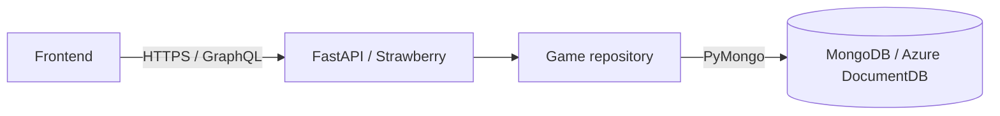

# Steam Doma — Backend

REST and GraphQL backend for **Steam Doma**, an educational RS School project. The frontend is maintained by the project team in a separate repository and will be deployed to Azure independently; this backend is developed individually.

## Stack

Python 3.15, FastAPI, Strawberry GraphQL, PyMongo Async, MongoDB / Azure DocumentDB, uv, pytest, Ruff, Docker, and GitHub Actions.

## Architecture



The backend exposes a GraphQL API for the game catalog and REST endpoints for operational checks. Resolvers use the repository layer to access game documents.

## Project structure

```text
src/steam_doma/             FastAPI app and game catalog
tests/                      Automated tests
scripts/                    Database setup and maintenance
docs/graphql-catalog.md     GraphQL catalog reference
compose.yaml                Local development services
Dockerfile                  Production image
.github/workflows/          CI/CD
```

## Getting started

Requirements: Git, Docker with Compose, and optionally VS Code with the Dev Containers extension. For local Python development, install uv and Python 3.15.

```bash
git clone https://github.com/amgSTRIDeR/Steam-Doma-Backend.git
cd Steam-Doma-Backend
```

Open in VS Code and run **Dev Containers: Reopen in Container**, or install dependencies locally:

```bash
uv python install 3.15
uv sync --locked
```

Create `.env` in the repository root:

```dotenv
DATABASE_PROVIDER=local
MONGO_URI=mongodb://127.0.0.1:27017
MONGO_DB_NAME=steam_doma
CORS_ORIGINS=http://localhost:5173,http://127.0.0.1:5173
```

Start the local database with `docker compose up -d mongo`, then run the API:

```bash
uv run --env-file .env uvicorn steam_doma.main:app \
    --host 0.0.0.0 --port 8000 --reload
```

The API is available at `http://localhost:8000`.

## API

| Endpoint | Description |
| --- | --- |
| `/graphql` | GraphQL API and interactive IDE |
| `/health` | Application and database health check |
| `/docs` | Swagger UI |
| `/openapi.json` | REST API OpenAPI specification |

GraphQL queries include `ping`, `games`, `game`, and `catalogFilters`.

```graphql
query {
  ping
}
```

See [GraphQL Catalog Documentation](docs/graphql-catalog.md) for catalog queries and examples. The catalog API is public; CORS is not authentication.

## Database

The database contains `games` and `seed_history` collections. To seed an empty database, place the Steam dataset at `data/steam_games.json` and run:

```bash
uv run --env-file .env python -m scripts.seed_games data/steam_games.json
uv run --env-file .env python -m scripts.setup_game_indexes
```

Seeding is an explicit administrative operation, not part of application startup or deployment. Do not run it against an already populated database.

For authorized Azure DocumentDB diagnostics, create `.env.azure` with the following settings and Azure-provided values:

```dotenv
DATABASE_PROVIDER=azure
MONGO_DB_NAME=steam_doma
AZURE_DOCUMENTDB_URI="mongodb+srv://<cluster-host>/?authMechanism=SCRAM-SHA-256&retryWrites=false&maxIdleTimeMS=120000"
AZURE_DOCUMENTDB_USERNAME="<username>"
AZURE_DOCUMENTDB_PASSWORD="<password>"
```

Keep credentials out of source control. Check connectivity with:

```bash
uv run --env-file .env.azure python scripts/check_azure_documentdb.py
```

## Development

```bash
uv run ruff check .
uv run ruff format --check .
DATABASE_PROVIDER=local MONGO_DB_NAME=steam_doma_test \
    uv run --env-file .env pytest -v
docker build -t steam-doma-backend:local .
```

Run tests against a separate local test database, never the production database.

## Azure deployment

The backend runs on Azure Container Apps in Brazil South and uses Azure DocumentDB. The deployment workflow is [backend-ci.yml](.github/workflows/backend-ci.yml). Pull requests to `main` run linting, formatting checks, tests, and image verification. Pushes to `main` publish the image to Azure Container Registry, deploy it, and run health and GraphQL smoke tests.

The deployed API URL is available in Azure Portal under **Container Apps → steam-doma-backend → Overview → Application Url**. Use `<API URL>/graphql` as the GraphQL endpoint. The frontend origin must be permitted by `CORS_ORIGINS`.

The catalog API currently has no authentication and should be treated as public. Database credentials are configured in Container Apps Secrets; the database firewall permits connections from Azure services, not exclusively this backend.
